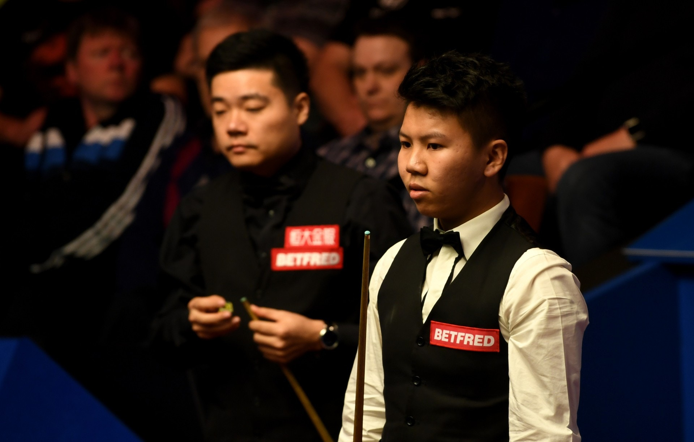
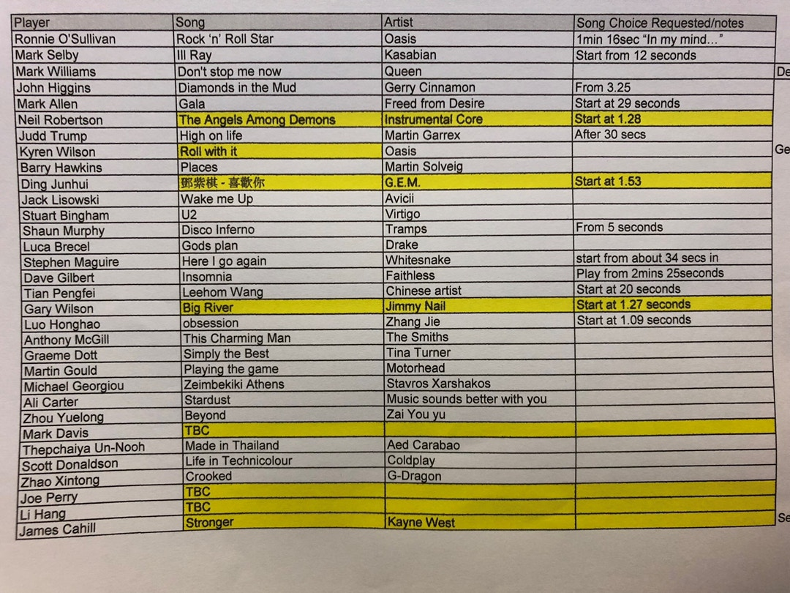

曼徹斯特樂團Oasis成為球手熱門之選，奧蘇利雲（Ronnie O'Sullivan）挑選了Definitely Maybe中的Rock 'n' Roll Star，威爾遜心水是What's the StoryMorning Glory?的Roll with It。奧蘇曾透露首次去演唱會就是Oasis1996年於Knebworth舉行的演唱會，又曾在訪問中唱Wonderwall，可見他對Oasis情有獨鍾。

衛冕的威廉斯同樣有品味，選擇了神級樂隊Queen霸氣十足的名曲Don't Stop Me Now，此曲在1978年面世，多年來在多個廣告成為配樂，又在2012倫敦奧運被英國運動員「重製」MV。

*奧蘇利雲喜愛林子祥外，也愛聽Oasis。（網上圖片）*

部份球手出場音樂

*丁俊暉出場音樂是香港歌手鄧紫棋（G.E.M）翻唱Beyond的喜歡你。*

*威廉斯出場音樂是Queen的Don’t Stop Me Now。*

*沙比選了李斯特樂隊Kasabian的 Ill Ray (The King)  。*

*田鵬飛的音樂是王力宏。*

*周躍龍的選擇如無意外應該是Beyond的不再猶豫。*

丁俊暉在首圈局數領以6：3安東尼麥基，他的出場音樂是香港歌手鄧紫棋（G.E.M.）翻唱Beyond金曲喜歡你，還標明要1分53秒開始播放。另一中國桌球手周躍龍在名單上是播Beyond的ZAI YOU YU，估計是翻譯有遺漏，相信是Beyond的不再猶豫。田鵬飛就選擇了王力宏，但歌曲不明。

希堅斯及沙比同樣撐同鄉，前者選了蘇格蘭歌手Gerry Cinnamon的歌曲，後者撐李斯特的Kasabian。另外Coldplay、Drake、The Smiths等都榜上有名。

*世界桌球錦標賽2019球手出場音樂。（網上圖片）*
