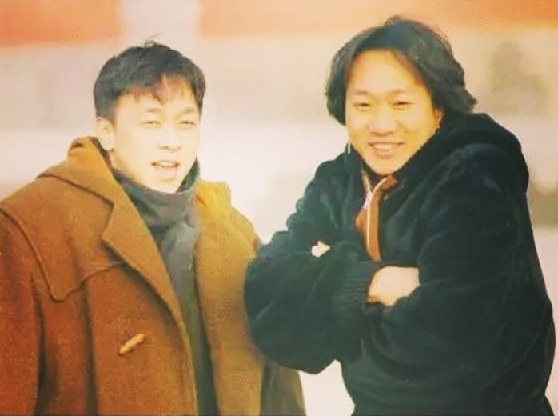
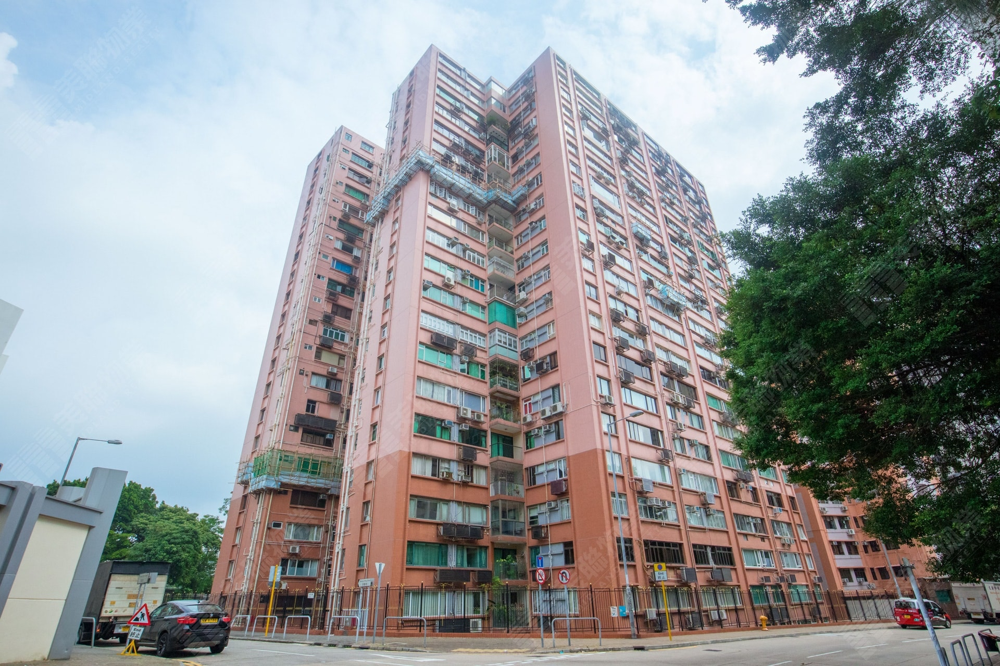
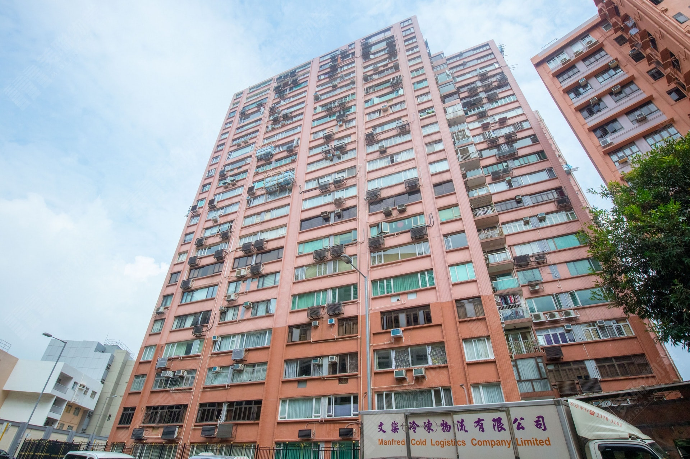
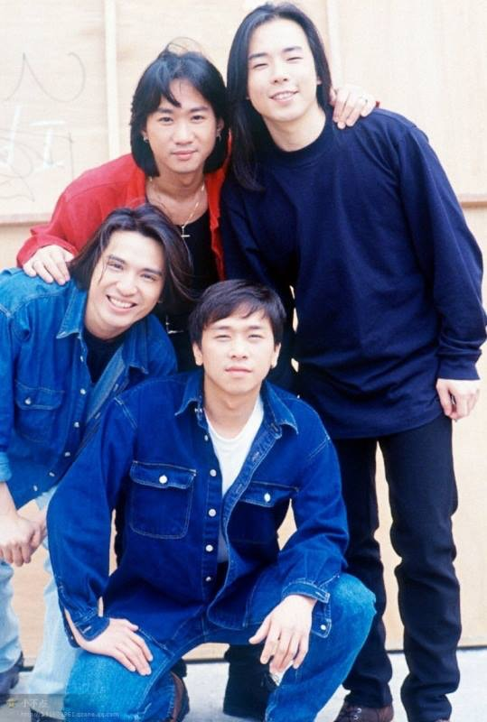
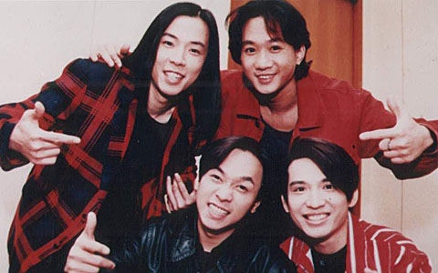
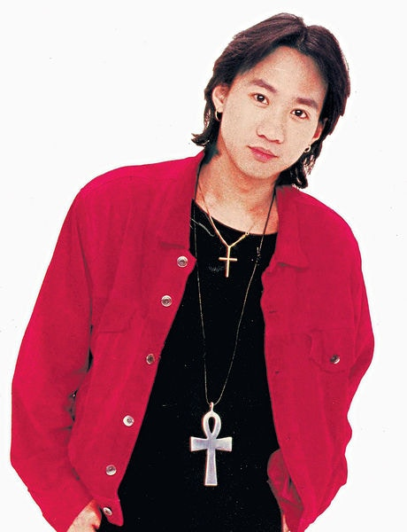
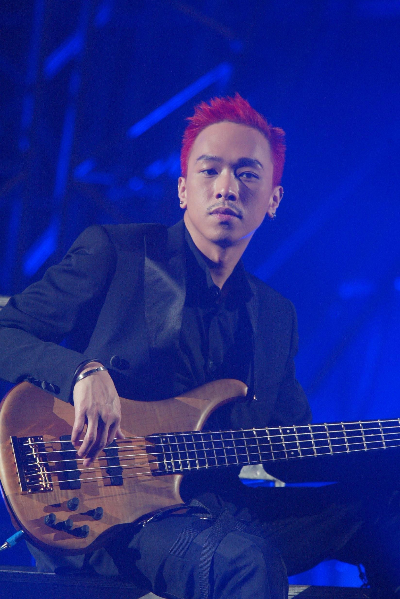

著名本地樂隊Beyond成員、兼為樂隊已故主音歌手及結他手黃家駒的胞弟黃家強，持有的何文田常康園一伙逾千呎單位，傳新近以2720萬元沽出。有指上述單位為常康園中層D室，實用面積1615平方呎，四房間隔，最近連同一個車位易手，成交價約2720萬元，成交呎價約16842元。

*已故Beyond樂隊主音歌手黃家駒及其弟黃家強。(kwkpbeyond@IG)*

據悉，2006年時，黃家強透過公司名義以1165萬元購入上述單位，是次易手帳面獲利1555萬元，單位升值約1.3倍。

## 何文田常康園相

*何文田常康園。（代理提供圖片）*

*何文田常康園。（代理提供圖片）*

## Beyond圖輯

*Beyond。（黃家強Facebook圖片）*

*Beyond組成初期曾有不同成員，於1988年結他手劉志遠離隊後，由黃家駒﹑葉世榮﹑黃貫中和黃家強的Beyond組合最為人熟悉。（網上圖片）*

*黃家駒。*

*家駒離世後，Beyond改以3人樂隊發展。*
