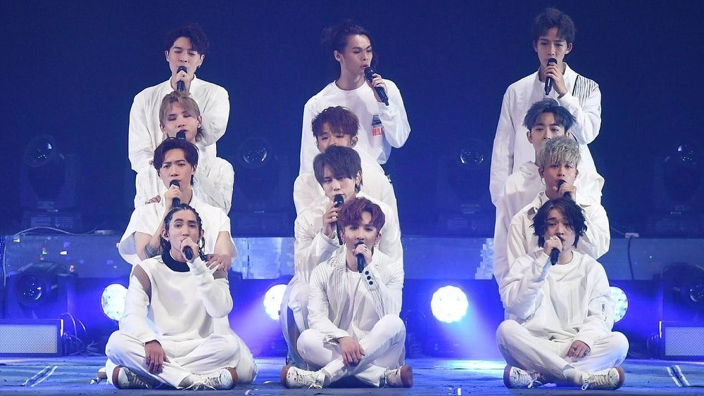
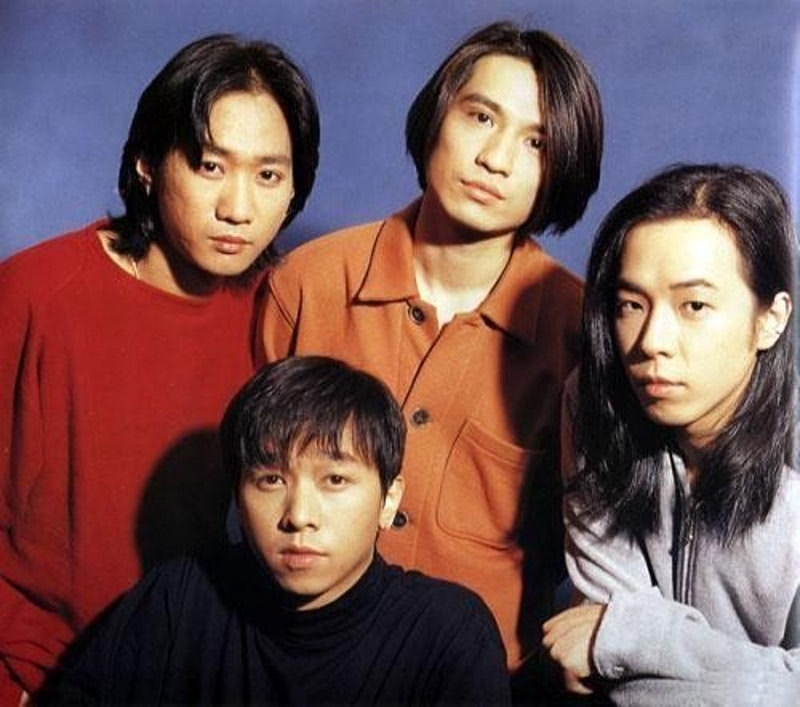
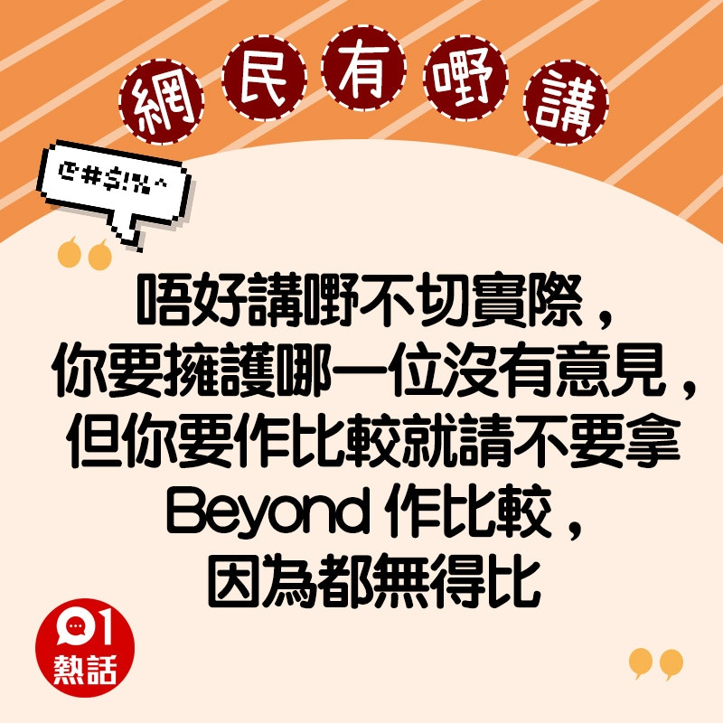
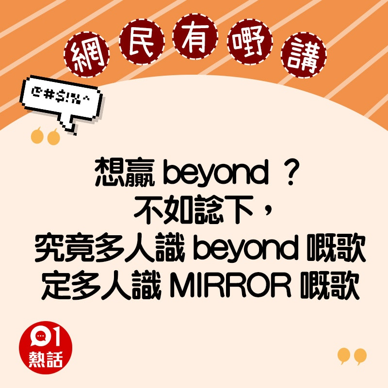
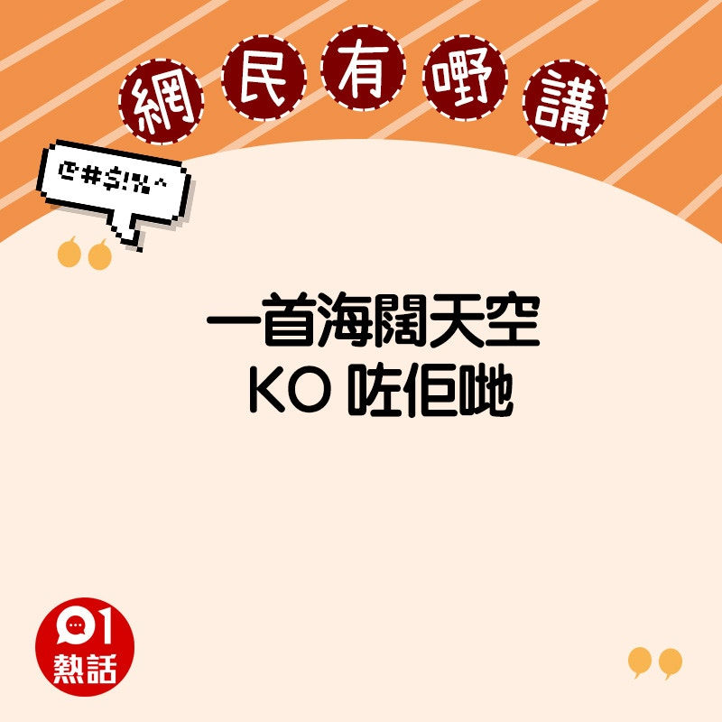
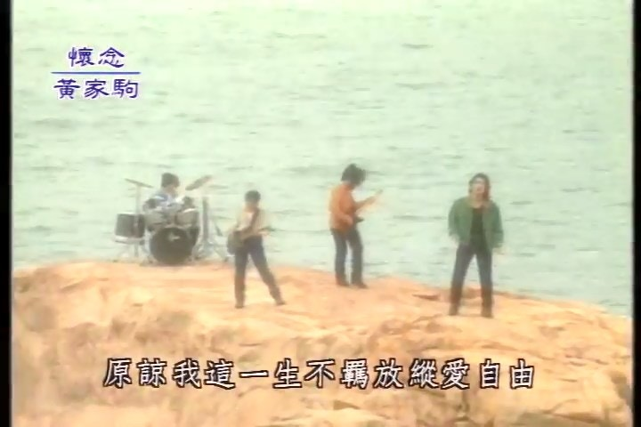

有網民於Facebook群組發文，指「有無人覺得MIRROR現時人氣，成就已經超越Beyond，不出1年應該可以輕鬆打敗X Japan」。短短一句話，同時「辣㷫」Beyond及X Japan紛絲，引發多方罵戰。

*有網民於Facebook群組發文，指「有無人覺得MIRROR現時人氣，成就已經超越Beyond，不出1年應該可以輕鬆打敗X Japan」。*

*搖滾樂隊Beyond是香港永恒經典。*

不少Beyond紛絲直指MIRROR未夠資格與Beyond比較，更遑論超越，「唔好講嘢不切實際」、「無得比」、「Beyond世一」，反問「Beyond嘅作品、意義、才華、聲線、努力、當年嘅競爭對手，你覺得邊一樣係超越？」、「你覺得20年後，喺街會仲聽到mirror定beyond嘅歌」。有鏡粉以姜濤的《Dear My Friend ,》反駁，「我派姜B一個人，呢一首歌，已經打敗咗」，再惹來Beyond紛絲反擊，「我派一句仍然『自由自我』，已經名留青史」。

## 即睇更多支持Beyond的網民精選留言

*支持Beyond的網民精選留言（HK01製圖）*

*支持Beyond的網民精選留言（HK01製圖）*

*支持Beyond的網民精選留言（HK01製圖）*

*支持Beyond的網民精選留言（HK01製圖）*

*支持Beyond的網民精選留言（HK01製圖）*

*支持Beyond的網民精選留言（HK01製圖）*

*Beyond是香港經典樂隊。*

*支持Beyond的網民精選留言（HK01製圖）*

*支持Beyond的網民精選留言（HK01製圖）*

*支持Beyond的網民精選留言（HK01製圖）*

*支持Beyond的網民精選留言（HK01製圖）*

也有X Japan支持者批評鏡粉失去理性，「同X Japan比，鏡粉係咪失去咗理性」、「唔該講還講，唔好拉埋X Japan講」、「我唔明點解要拎隊靠樣搵食嘅嚟同人地啲實力派做對比」。

不過也有「中立派」網民認為，MIRROR及Beyond屬於不同時代，類型領域亦不同，不應比較，「mirror係組合，Beyond、X Japan係樂隊」、「兩個時代嚟」、「基本上就唔能夠相提並論，完全係兩樣嘢」。另有網民認為樓主是「曲線」，並非真鏡粉。
